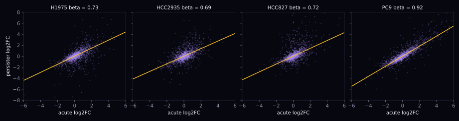
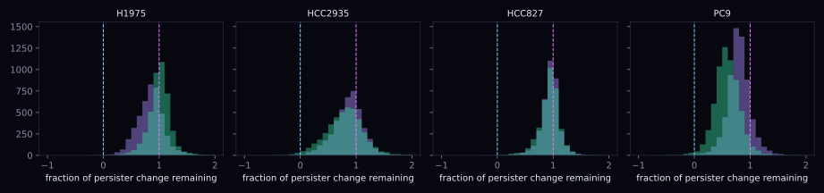

# PersistTrace

**The tumour shrinks. Some cancer cells survive. What are they becoming?**


Lung cancers with EGFR mutations often respond to osimertinib, yet a few cells survive without any new mutation. These drug-tolerant persisters change state instead of DNA, and they can seed relapse. PersistTrace asks which of their changes are the persister state itself, which are just day-one drug stress, and which fade once the drug is stopped. Every candidate gene then gets an evidence passport saying how far the evidence actually goes.

**Live observatory:** https://pritidipadas.github.io/persist-trace/
Everything on that page is generated by the pipeline in this repository from public data, rerun by GitHub Actions on every change.

## What the real data show

Data: 60 RNA-seq samples from GEO [GSE193258](https://www.ncbi.nlm.nih.gov/geo/query/acc.cgi?acc=GSE193258) (Criscione et al., npj Precision Oncology 2022, [doi:10.1038/s41698-022-00337-w](https://doi.org/10.1038/s41698-022-00337-w)). Four EGFR-mutant lines (PC9, NCI-H1975, HCC827, HCC2935), each untreated, after 24 h of osimertinib, as 21-day persisters, 24 h after washout and after regrowth, in triplicate. 16,172 genes were testable in all four lines.

1. **Persisters still carry most of the day-one stress response.** The robust slope of the persister change on the acute change is 0.69 to 0.92 depending on the line. Treated-versus-control lists are therefore dominated by stress genes.
2. **Removing that stress helps on an unseen cell line (H1, preregistered).** Built on three lines and tested on the fourth, a naive treated-versus-control signature separated persisters from acute samples with a mean AUROC of 0.61; for HCC827 it ranked them backwards (0.11). The persister-specific signature reached 1.00 in all four folds. Each fold has only three persister and three acute samples, so this is a clean ranking on small numbers, not a large-sample accuracy.
3. **But persister-specific genes are more line-specific (H1b, contradicted).** 56% of them replicate in the held-out line, against 89% for naive genes. The specific persister programme differs more between lines than the shared stress does.
4. **The cells remember for weeks.** For genes changed in persisters, the median fraction of the change still present after regrowth was 101% (H1975, 3 days), 95% (HCC827, 4 days), 81% (HCC2935, 10 days) and 58% (PC9, 7 days). Fitted memory half-lives run from about 8 days (PC9) to 22 days (HCC827). 1,429 genes stay changed after regrowth in at least three lines; only 4 reverse reproducibly. Reversal happens, but mostly in PC9.
5. **What persisters switch on beyond stress.** Epithelial-mesenchymal transition rises (programme score 9.4), which reproduces the original paper's persistent EMT cluster. Oxidative phosphorylation, fatty-acid metabolism and cholesterol homeostasis fall. Inferred SREBF1/2 activity drops and SMAD2/3 and NFATC1 activity rises.
6. **The replication paradox.** Proliferation programmes crash after 24 h, then partly recover in persisters while the drug is still on. CDK6 rises in persisters but not after 24 h in H1975 and HCC2935, which fits recent work linking CDK4/6 to replication stress under EGFR inhibition.
7. **Known persister genes are mostly early responders.** BTG1, ING4, PNRC1 and CALCOCO1, whose knockdown impaired persister formation in a 2026 study, are reproducibly up in persisters, yet nearly all of that rise is already present at 24 h. They look like early gatekeepers rather than markers of the settled persister state.
8. **TROP2 is contested, and this dataset adds a twist.** A 2025 knockout study found TROP2 unnecessary for persister formation; a 2026 study reported it supports persister maintenance. Here it rose in PC9 and H1975 persisters, not in HCC827 or HCC2935, and mostly already at 24 h. The passport shows all three facts side by side.
9. **Honest limits.** Five-condition classifiers on a held-out line reach a balanced accuracy of about 0.77 (chance 0.20), and the decomposition did not improve them. Gene-level lists are sensitive to thresholds and to which line is left out (Jaccard 0.17 to 0.33). Programme-level conclusions are the stable part.

## The four ideas

| Idea | What it does |
|---|---|
| Persistence-specific decomposition | P = beta A + S per gene and line, random-effects meta-analysis across lines |
| Reversibility map and memory | Population-level withdrawal classes, memory fraction, exponential half-life |
| Evidence passports | Six separate dimensions, written rules for the final label, contradictions listed |
| Molecular escape graph | Every edge typed as measured, inferred or published, with its source |




## Run it

```bash
pip install -r requirements.txt && pip install -e .
python -m persisttrace.pipeline            # downloads GEO data, writes site/data and figures
pytest -q                                  # unit tests on synthetic data with known answers
octave --eval "addpath('matlab'); run_all('build/octave')"   # independent cross-check
python -m http.server -d site              # open http://localhost:8000
```

## Repository

```
persisttrace/   analysis package (GEO download, DESeq2 contrasts, decomposition, reversibility,
                programmes, passports, graph, benchmark, robustness, switching model, figures)
matlab/         Octave/MATLAB re-implementation of the memory fit and switching model
evidence/       hand-checked literature records with PMIDs and DOIs
config/         every threshold in one file
site/           the observatory (vanilla JS, canvas and SVG, no build step, works offline)
tests/          scientific invariants: no edge without a source, no dependency without a perturbation record,
                no held-out leakage, no unsupported claims or em dashes in public text
docs/           protocol, claim boundaries, prior art, weaknesses, judge playbook, limitations
```

## Documents

* [Weaknesses in the original plan and what changed](docs/WEAKNESSES_AND_UPGRADES.md)
* [Judge playbook and demo script](docs/JUDGE_PLAYBOOK.md)
* [Analysis protocol, frozen before the first real run](docs/ANALYSIS_PROTOCOL.md)
* [Claim boundaries](docs/CLAIM_BOUNDARIES_AND_EVIDENCE_STANDARD.md)
* [Prior art and datasets](docs/PRIOR_ART_AND_DATASETS.md)
* [Methods](docs/METHODS.md)
* [Limitations and negative findings](docs/LIMITATIONS_AND_NEGATIVE_FINDINGS.md)

## Literature used in the passports

Checked against PubMed on 2026-11-26: Criscione 2022 ([doi](https://doi.org/10.1038/s41698-022-00337-w)), Baldacci 2025 ([doi](https://doi.org/10.1158/2159-8290.CD-24-1515)), Liao 2026 ([doi](https://doi.org/10.1016/j.ccell.2026.05.020)), Chang 2026 ([doi](https://doi.org/10.3892/mmr.2026.14017)), Kashima 2021 ([doi](https://doi.org/10.1158/0008-5472.CAN-20-2811)), Isozaki 2023 ([doi](https://doi.org/10.1038/s41586-023-06303-1)), Oren 2021 ([doi](https://doi.org/10.1038/s41586-021-03796-6)), Lu 2026 ([doi](https://doi.org/10.21037/jtd-2025-aw-2071)), Gini 2025 preprint ([doi](https://doi.org/10.1101/2024.03.12.584638)).

## Scope

PersistTrace is a computational research framework for cell-line models. It does not diagnose patients, recommend treatment, show that any gene causes resistance or replace laboratory validation.

MIT licence. Built by PRITIDIPADAS.
